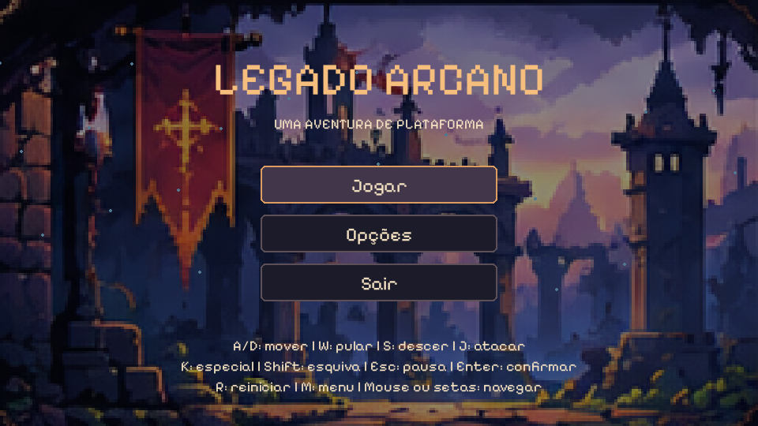
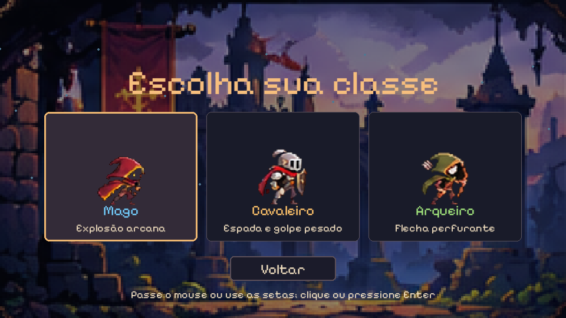
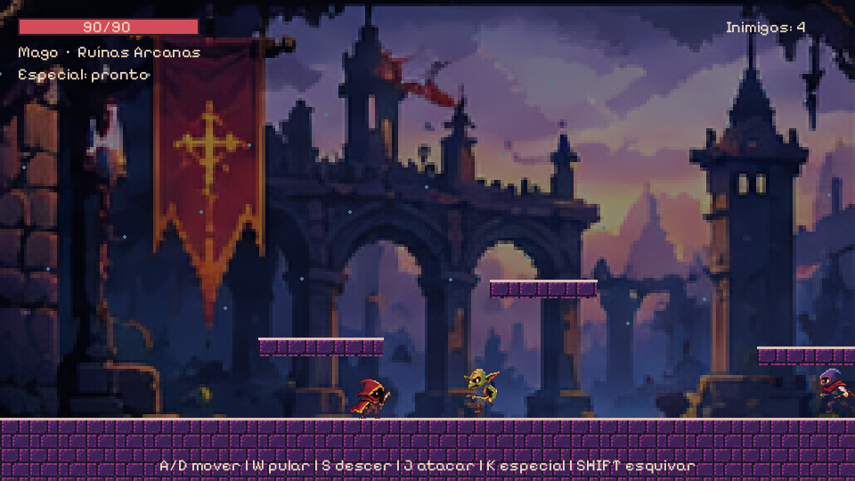

# Legado Arcano

Um jogo de aventura e plataforma 2D para Windows. Escolha entre Mago, Cavaleiro e Arqueiro, explore quatro áreas, derrote os inimigos e enfrente o Guardião Ancião. Esta é uma **demo linear**, não um jogo completo.



## Como baixar e jogar no Windows

### Se você recebeu o jogo pronto

1. Baixe o arquivo **`LegadoArcano_Entrega.zip`** disponibilizado pelo responsável pela entrega.
2. Clique com o botão direito no ZIP e escolha **Extrair Tudo**.
3. Abra a pasta extraída `LegadoArcano` e execute **`LegadoArcano.exe`**.
4. No menu inicial, escolha **Jogar** e selecione uma classe com o mouse ou com as setas e Enter.

Não é necessário instalar Python para jogar a versão pronta. Extraia a pasta inteira e mantenha todos os arquivos, incluindo `assets`, junto ao executável. O ZIP de entrega precisa ser fornecido separadamente: baixar o código do repositório não cria o executável automaticamente.

### Se você baixou o código-fonte

O botão **Code → Download ZIP** do GitHub baixa o código do projeto. Extraia o arquivo, instale [Python 3.12 para Windows](https://www.python.org/downloads/) e, na pasta extraída que contém `main.py`, abra o PowerShell e execute:

```powershell
py -3.12 -m venv .venv
.\.venv\Scripts\python.exe -m pip install -r requirements.txt
.\.venv\Scripts\python.exe main.py
```

É necessário acesso à internet para instalar as dependências. Se o comando `py -3.12` não funcionar, confira se o Python 3.12 e o inicializador `py` estão instalados. Para jogar novamente depois da instalação, execute apenas o último comando na pasta do projeto.

## Como jogar



Escolha o **Mago** para atacar com projéteis e uma explosão, o **Cavaleiro** para lutar com espada e golpe pesado ou o **Arqueiro** para disparar flechas e um tiro perfurante. A habilidade especial possui tempo de recarga.

Derrote todos os inimigos de cada área e siga para o portal à direita. Evite os espinhos e observe os avisos dos ataques inimigos. Na arena final, derrote o Guardião Ancião e alcance o portal para vencer. A vida é parcialmente recuperada entre as áreas; se chegar a zero, a partida termina. As bordas claras mostram onde é possível aterrissar nas plataformas.



## Controles

| Ação | Teclas |
| --- | --- |
| Mover | A / D ou setas esquerda / direita |
| Pular | W, seta para cima ou Espaço |
| Descer de plataforma elevada | S ou seta para baixo |
| Ataque básico | J ou Z |
| Habilidade especial | K |
| Esquiva | Shift |
| Pausar / continuar | Esc |
| Navegar e confirmar nos menus | Mouse ou setas e Enter |

Na pausa, use **Enter** para continuar, **R** para reiniciar ou **M** para voltar ao menu. Após a vitória ou derrota, **R** reinicia e **Enter** retorna ao menu. Em **Opções**, é possível ligar ou desligar o som.

## Gerar o pacote de entrega

Para quem vai distribuir o jogo no Windows, primeiro instale as dependências do código-fonte conforme os passos acima. Em seguida, na pasta do projeto, execute:

```powershell
.\.venv\Scripts\python.exe -m pip install -r requirements-build.txt
.\build-windows.ps1
```

O pacote será criado em `dist/LegadoArcano_Entrega.zip`. Envie esse ZIP ao jogador; ele contém o executável, os recursos e as instruções. Se o PowerShell bloquear a execução do script, use `powershell -ExecutionPolicy Bypass -File .\build-windows.ps1` na pasta do projeto.

## Informações do projeto

- `main.py`: inicia o jogo.
- `src/`: código do jogo; `assets/`: imagens, fontes, sons e respectivas licenças.
- `tests/`: testes automatizados; `docs/`: documentação complementar.
- Consulte [créditos dos recursos](docs/ASSETS.md), [testes](docs/TESTES.md) e [requisitos acadêmicos](docs/REQUISITOS_ACADEMICOS.md).
